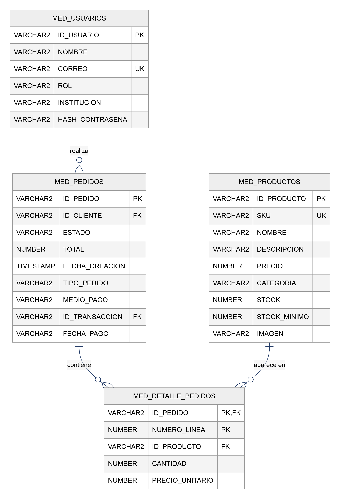
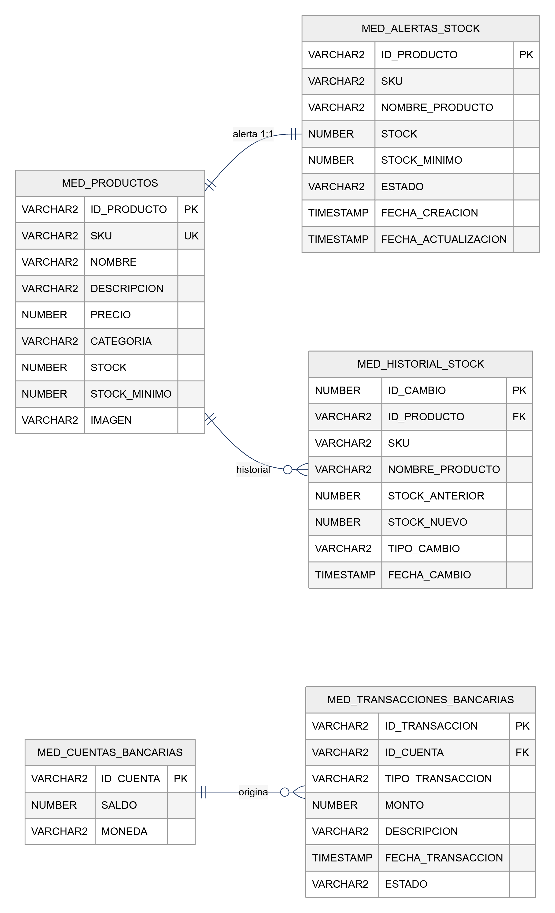

# INFORME FINAL — PROYECTO MEDISTOCK

## 1. PORTADA

**Título:** Medistock — Sistema de inventario y pedidos con MongoDB como base principal y Oracle PL/SQL como réplica y motor de lógica de negocio

**Asignatura:** Taller de Base de Datos

**Carrera:** Ingeniería en Informática

**Integrantes:**
- Nombre completo: ______________________________
- Nombre completo: ______________________________

**Profesor guía:** ______________________________

**Institución:** ______________________________

**Fecha de entrega:** ____ / ____ / ________

---

## 2. INTRODUCCIÓN

Medistock es un sistema de inventario y pedidos pensado para una empresa que comercializa insumos médicos. La aplicación administra productos, stock, pedidos y alertas, y lo hace sobre dos motores que cumplen roles distintos: MongoDB guarda la información como documentos y Oracle mantiene una réplica relacional donde vive la lógica de negocio escrita en PL/SQL.

La decisión de usar PL/SQL no fue decorativa. Cuando el volumen de datos crece, tareas como calcular el valor del inventario, detectar productos bajo el mínimo o marcar cientos de pedidos como enviados dejan de ser consultas simples y pasan a ser procesos que deben ejecutarse siempre igual, dentro del motor y sin depender de que la aplicación se acuerde de hacerlo. PL/SQL nos permite concentrar esas reglas en la base de datos: funciones que devuelven indicadores, procedimientos que actualizan lotes de registros, validaciones que rechazan datos inválidos y triggers que auditan cada cambio de stock. El resultado es un sistema donde la información principal fluye desde MongoDB, y Oracle se encarga de validarla, calcularla y dejarla registrada.

Este informe describe el contexto del proyecto, la problemática que resolvimos, la arquitectura híbrida que adoptamos y las conclusiones que sacamos del proceso.

---

## 3. CONTEXTO DEL PROYECTO

Medistock nace en una distribuidora de insumos clínicos que trabaja con hospitales, clínicas y clientes particulares. Su catálogo incluye desde artículos de bajo costo y alto rotación, como gasas o guantes, hasta equipamiento de mayor valor, como oxímetros o termómetros infrarrojos. Cada producto tiene un precio, una categoría, una imagen y, sobre todo, un nivel de stock que debe compararse permanentemente contra un mínimo definido por la empresa.

A eso se suma el flujo comercial: los clientes generan pedidos con varias líneas, cada línea apunta a un producto y una cantidad, y los pedidos avanzan por estados como pendiente, pagado o enviado. La empresa necesitaba, además, responder rápido a tres preguntas cotidianas: qué productos están por agotarse, cuánto vale el inventario disponible y qué pedidos incluyen cada producto de una categoría determinada. Todo ello en un negocio donde quedarse sin un insumo crítico puede significar detener una atención clínica.

El equipo trabaja con una aplicación web en Node.js, cuyo backend ya utilizaba MongoDB como almacén principal. La evaluación del taller pedía incorporar Oracle y demostrar que la lógica PL/SQL podía convivir con esa arquitectura sin reemplazarla.

---

## 4. PROBLEMÁTICA

Antes de esta arquitectura, la información vivía únicamente en MongoDB y los cálculos se resolvían en la aplicación. Eso traía cuatro problemas concretos.

Primero, los datos estaban dispersos en la lógica del backend: cada consulta de stock, cada reporte y cada validación se escribía en JavaScript, de modo que las reglas de negocio quedaban repartidas en varios archivos y era fácil que dos pantallas calcularan lo mismo de forma distinta.

Segundo, los reportes eran lentos y frágiles. Obtener el valor total del inventario o listar los productos bajo el mínimo implicaba traer los documentos al servidor de aplicaciones y recorrerlos en memoria. Con pocos productos funcionaba; al crecer el catálogo, el tiempo de respuesta y el consumo de memoria se volvían un problema, y cualquier cambio en la regla obligaba a redesplegar la aplicación.

Tercero, no había auditoría real del stock. Si un usuario corregía existencias directamente o un proceso las sobrescribía, no quedaba registro de quién, cuándo ni con qué valor se había producido el cambio. Sin historial, detectar una merma o explicar una diferencia era cuestión de suerte.

Cuarto, las validaciones dependían del cliente. Una actualización enviada por la API, por un script administrativo o por una consola de base de datos podía dejar un stock negativo o un precio inválido, porque la única barrera era el código de la aplicación. Faltaba un control que se aplicara siempre, sin importar quién escribiera.

---

## 5. SOLUCIÓN PROPUESTA

Optamos por una arquitectura híbrida de dos capas. MongoDB sigue siendo la fuente de verdad: ahí se crean y modifican los productos, pedidos y usuarios. Oracle mantiene una réplica relacional de esas entidades en tablas `MED_*` y, sobre esa réplica, implementa la lógica PL/SQL de la rúbrica. La comunicación es unidireccional —de Mongo hacia Oracle— y la replica un paquete ya existente en el proyecto.

El paquete `MEDISTOCK_SINCRONIZACION`, a través del procedimiento `APLICAR_CAMBIO`, recibe tres datos: la entidad afectada, la acción realizada y el documento serializado como JSON. Internamente extrae los campos con funciones de JSON, como `JSON_VALUE` y `JSON_TABLE`, y aplica un `MERGE` sobre la tabla correspondiente. Esa decisión es la que hace que el mismo procedimiento sirva para altas y modificaciones sin cambiar una línea: si el identificador no existe, inserta; si existe, actualiza. En la práctica lo comprobamos enviando un producto nuevo y luego el mismo producto modificado, y en ambos casos la fila quedó consistente.

Los triggers cubren la integridad y la trazabilidad. El proyecto ya contaba con un trigger de auditoría posterior a cada cambio de stock, que escribe en `MED_HISTORIAL_STOCK`; nosotros agregamos uno de validación previo, que rechaza cualquier intento de dejar el stock en negativo con un mensaje de negocio que indica el producto y el valor recibido. Lo interesante es que la tabla ya tenía una restricción `CHECK` para el mismo caso, pero el trigger se ejecuta antes y entrega un error entendible en lugar de un mensaje técnico. Además, al ser `FOR EACH ROW`, se aplica por igual a la API, a un script o a una consola, lo que cierra la brecha que mencionamos en la problemática.

Para los reportes usamos tres mecanismos de PL/SQL que se complementan. El RECORD representa en memoria una fila del reporte, con campos que heredan el tipo de la columna y un campo calculado que no existe en la tabla —las unidades faltantes—, evitando declarar seis variables sueltas por cada consulta. Los cursores, algunos explícitos y parametrizados, recorren y filtran las filas; el reporte de stock bajo prioriza los productos con mayor faltante, y el reporte por categoría usa dos cursores anidados para mostrar cada producto con sus pedidos asociados sin traer un producto cartesiano. El VARRAY, por su parte, transporta una lista acotada de hasta cien identificadores de pedido en un solo parámetro, de modo que marcar cincuenta pedidos como enviados es una llamada al procedimiento y no cincuenta viajes de red. A eso sumamos una función que calcula el valor total del inventario multiplicando precio por stock, un procedimiento con excepción definida por el usuario para rechazar precios negativos y un paquete, `MEDISTOCK_GESTION`, que expone todo lo anterior como una interfaz única sin duplicar la lógica ya probada.

La prueba de concepto de esta unión es `demo_conexion.js`. El script, escrito en Node.js con los drivers oficiales de ambos motores, ejecuta seis pasos visibles en pantalla: conecta a MongoDB y cuenta los documentos, busca un producto de demostración y lo inserta o le suma stock si ya existe, conecta a Oracle y muestra el estado previo de la tabla, invoca `APLICAR_CAMBIO` con el documento serializado, consulta la fila recién replicada y finalmente compara el stock de ambos motores. El script no confía en la respuesta del procedimiento: verifica leyendo la tabla, y solo declara éxito si los dos valores coinciden. Las credenciales se leen de variables de entorno o de un archivo `.env`, nunca del código.

Los números de nuestras ejecuciones reales sirven para dimensionar el trabajo: con los datos de prueba, el reporte detecta dos productos críticos y dieciocho unidades faltantes, el inventario total asciende a 821.200, el lote de tres pedidos actualiza dos y omite correctamente uno inexistente, y la llamada PL/SQL desde Node tarda del orden de veinte milisegundos. El informe no incluye el código por razones de extensión: ambos archivos se adjuntan completos y comentados.

---

## 6. MODELO RELACIONAL Y DIAGRAMA

Las ocho tablas de la réplica no son una lista suelta: se ordenan alrededor de dos núcleos. El primero es el catálogo, con `MED_PRODUCTOS` como tabla central. El segundo es la operación comercial, con `MED_PEDIDOS` como encabezado y `MED_DETALLE_PEDIDOS` como su detalle. Alrededor de esos dos núcleos cuelgan el dinero (`MED_CUENTAS_BANCARIAS` y `MED_TRANSACCIONES_BANCARIAS`), las personas (`MED_USUARIOS`) y el control de existencias (`MED_ALERTAS_STOCK` y `MED_HISTORIAL_STOCK`).

La relación más importante es la de un pedido con sus líneas. `MED_PEDIDOS` guarda una fila por pedido, con su cliente, estado, total y datos de pago. `MED_DETALLE_PEDIDOS` guarda una fila por producto dentro de ese pedido, y su clave primaria es compuesta: `ID_PEDIDO` más `NUMERO_LINEA`. Además, `ID_PEDIDO` es clave foránea hacia `MED_PEDIDOS`, así que un pedido con dos productos son tres filas en total —una en el encabezado y dos en el detalle— y no es posible registrar una línea huérfana. El detalle guarda también el precio unitario del momento de la venta, para que un cambio posterior de precio no altere lo que ya se cobró.

El catálogo se conecta con el resto por `ID_PRODUCTO`. El detalle de pedidos lo usa para saber qué se vendió; el historial de stock lo usa para saber a qué producto corresponde cada cambio; y las alertas lo usan como clave primaria propia, de modo que existe como máximo una alerta vigente por producto: es una relación uno a uno. `MED_HISTORIAL_STOCK`, en cambio, es uno a muchos: cada modificación de existencias agrega una fila nueva con su propio `ID_CAMBIO` y conserva el stock anterior y el nuevo. Ese es justamente el registro que escribe el trigger de auditoría, y por eso el historial crece mientras el producto sigue siendo el mismo.

En el plano comercial, `MED_USUARIOS` se relaciona con `MED_PEDIDOS` a través de `ID_CLIENTE`, y el pago se resuelve en dos pasos: una cuenta (`MED_CUENTAS_BANCARIAS`) origina movimientos en `MED_TRANSACCIONES_BANCARIAS`, y el pedido apunta a la transacción que lo pagó mediante `ID_TRANSACCION`.

Hay un detalle del diseño que conviene declarar con honestidad. En Oracle solo dos de esas uniones existen como restricción de clave foránea: la del detalle con el pedido y la de la transacción con la cuenta. Las demás son referencias lógicas que el paquete `MEDISTOCK_SINCRONIZACION` mantiene al replicar, porque las tablas se cargan con `MERGE` a medida que llegan los documentos desde MongoDB y el orden de llegada no está garantizado. Imponer una restricción estricta en ese escenario obligaría a sincronizar primero usuarios, después cuentas, después productos y al final pedidos; en cambio, dejando la integridad en manos del paquete y del trigger, la réplica tolera un desfase momentáneo y converge. Ambas figuras marcan todas las referencias, y la explicación de cuáles son constraints reales queda en los comentarios de los archivos `modelo_relacional_1a.mmd` y `modelo_relacional_1b.mmd`.

Para que el modelo se lea bien en papel, lo presentamos en dos figuras complementarias. La Figura 1A reúne el núcleo comercial —quién compra, qué pide y qué producto hay detrás de cada línea—, y la Figura 1B cubre el inventario y el dinero: existencias, alertas, historial de cambios y movimientos bancarios. `MED_PRODUCTOS` aparece en las dos, porque es el punto donde se cruzan ambos mundos.

## 7. CONCLUSIONES

El proyecto nos dejó tres aprendizajes que van más allá de la sintaxis.

El primero es que la integridad de los datos no puede depender del cliente. Mientras la validación vivió solo en JavaScript, cualquier vía alterna podía romper la regla. Al mover la restricción al motor, con un trigger que se ejecuta antes de la escritura, la garantía dejó de ser una convención del equipo y pasó a ser una propiedad de la base de datos. Entendimos que la pregunta correcta no es "¿mi aplicación valida esto?", sino "¿qué impide que alguien lo rompa?".

El segundo es el valor de automatizar la lógica en el lugar donde están los datos. Un cálculo como el valor del inventario, escrito una vez como función, sirve a la aplicación, al reporte y al paquete sin copias ni divergencias. Lo mismo ocurre con los procedimientos de actualización masiva: el VARRAY redujo decenas de llamadas a una sola y, de paso, nos obligó a pensar en los casos borde, como el identificador que no existe o el pedido que ya estaba enviado. Oracle no solo almacena: ejecuta reglas de negocio de forma consistente.

El tercero es que una arquitectura híbrida exige criterio, no solo herramientas. MongoDB nos dio flexibilidad para modelar documentos; Oracle nos dio rigor para auditar, validar y reportar. La clave fue definir el flujo en una sola dirección y verificarlo con una prueba concreta en lugar de asumirlo. Aprendimos también que un script de demostración honesto es parte del diseño: comparar los dos motores al final nos obligó a detectar y corregir errores reales de compilación y de sincronización que una revisión superficial habría dejado pasar.

---

## 8. BIBLIOGRAFÍA

- Oracle Corporation. *Oracle Database PL/SQL Language Reference, 21c*. https://docs.oracle.com/en/database/oracle/oracle-database/21/lnpls/
- Oracle Corporation. *Oracle Database SQL Language Reference — Funciones JSON y MERGE, 21c*. https://docs.oracle.com/en/database/oracle/oracle-database/21/sqlrf/
- Oracle Corporation. *node-oracledb: Documentación del driver oficial para Node.js*. https://node-oracledb.readthedocs.io/
- MongoDB Inc. *MongoDB Node.js Driver Documentation*. https://www.mongodb.com/docs/drivers/node/current/
- MongoDB Inc. *MongoDB Manual — Modelado de documentos*. https://www.mongodb.com/docs/manual/data-modeling/
- Apuntes y material de clases de la asignatura Taller de Base de Datos.

---

## 9. ANEXOS

**Anexo A — Modelo relacional.** El diagrama relacional de las ocho tablas (`MED_PRODUCTOS`, `MED_USUARIOS`, `MED_PEDIDOS`, `MED_DETALLE_PEDIDOS`, `MED_CUENTAS_BANCARIAS`, `MED_TRANSACCIONES_BANCARIAS`, `MED_ALERTAS_STOCK` y `MED_HISTORIAL_STOCK`) se incluye en este documento como la Figura 1 (sección 6). Por legibilidad se dividió en dos partes: la Figura 1A con el núcleo comercial y la Figura 1B con el área de inventario y bancos. Las imágenes también se entregan como archivos aparte (`modelo_relacional_1a.png` y `modelo_relacional_1b.png`), y el código fuente que las genera está adjunto en `modelo_relacional_1a.mmd` y `modelo_relacional_1b.mmd`.

**Anexo B — Código PL/SQL.** El archivo `evaluacion_medistock.sql` contiene, comentado línea por línea, la preparación del tipo VARRAY, los datos de prueba idempotentes, el bloque con RECORD, la función de valor de inventario, el procedimiento con VARRAY, los cursores anidados, el procedimiento con excepción definida por el usuario, el trigger de validación de stock, el paquete `MEDISTOCK_GESTION` y las pruebas finales de aceptación.

**Anexo C — Prueba de conexión.** El archivo `demo_conexion.js` contiene el script de sincronización MongoDB → Oracle descrito en la sección 5, con su configuración por variables de entorno y el manejo de errores que traduce los fallos más comunes del driver a instrucciones concretas.

**Anexo D — Salida de referencia.** El archivo `salida_esperada_sqlplus.txt` guarda la captura real de una ejecución completa, útil para comparar resultados durante la demostración.

**Anexo E — Guion de presentación.** El archivo `GUION_PRESENTACION.md` detalla el orden de la exposición, los comandos utilizados y las explicaciones técnicas de cada objeto de la rúbrica.

**Anexo F — Código fuente del diagrama.** El diagrama está escrito en Mermaid y se entrega en dos archivos, uno por figura: `modelo_relacional_1a.mmd` (núcleo comercial) y `modelo_relacional_1b.mmd` (inventario y bancos). Además se incluye `modelo_relacional.mmd` con el modelo completo en una sola vista, útil para editar las relaciones de conjunto. Los tres archivos se pueden abrir en mermaid.live o pegar en draw.io (Arrange → Insert → Advanced → Mermaid) para regenerar o modificar las figuras; las versiones exportadas son `modelo_relacional_1a.png`, `modelo_relacional_1b.png` y `modelo_relacional.png`.
